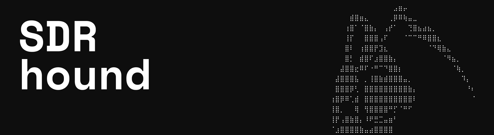

# SDRhound

An Android receiver for RTL-SDR (RTL2832U/R820T) USB dongles: wideband radio, ADS-B aircraft
tracking, GSM control-channel analysis, and NOAA satellite imagery — all demodulated on-device.
No server, no account, no subscription.

**[→ Project website](https://wrait8.github.io/SDRhound/)**

---

## Features

### Radio
- WFM / NFM / AM / USB / LSB, adjustable bandwidth per mode
- Spectrum + waterfall display, peak hold, band-plan overlay
- Squelch with hysteresis
- Records 48 kHz WAV audio and/or raw IQ (`.cu8`)
- 6 selectable display palettes (Mono, Green, Amber, Ice, Night, Violet)

### ADS-B
- Decodes 1090 MHz Mode S extended squitter (DF17/18) and identity replies (DF5/21) directly
  from raw IQ — no external dump1090 dependency
- Global CPR position decoding from paired even/odd frames
- Offline radar-style map with range rings, trails, callsigns, flight levels — or a sortable list

### GSM
- Passive FCCH beacon scanner across GSM850/GSM900
- Live control-channel receiver: burst sync → soft-decision deinterleave → Viterbi → Fire code,
  with self-calibrating frequency offset
- Three live views: raw hex console, IMSI/TMSI catcher (from paging + SI3), and a Wireshark-style
  decoded packet list
- Streams decoded messages live as GSMTAP (UDP, the same format/port `grgsm_livemon` uses) and can
  record them straight to a `.pcap` file
- Cell locator: resolves the serving cell (MCC/MNC/LAC/CI) to a map position via the
  [OpenCellID](https://opencellid.org) API

### Satellite
- NOAA 15/18/19 APT image decoding (~137 MHz NFM), live scrolling preview, save as PNG

---

## Requirements

- An RTL-SDR dongle (RTL2832U + R820T/R820T2 tuner)
- A USB-OTG cable/adapter
- Android 8.0 (API 26) or newer
- Network access only if you use GSMTAP streaming or the OpenCellID cell locator

## Build & install

```bash
git clone https://github.com/wrait8/SDRhound.git
cd SDRhound
./gradlew installDebug      # installs to a connected/adb-visible device
# or
./gradlew assembleDebug     # APK lands in app/build/outputs/apk/debug/
```

Open the project in Android Studio for day-to-day development.

## Project structure

| File | What it does |
|---|---|
| `MainActivity.kt` | Compose UI: spectrum/waterfall view, all four mode panels, settings, dialogs |
| `SdrEngine.kt` | rtl_tcp client, FFT + waterfall buffer, demod orchestration, GSM/ADS-B/APT state |
| `Demodulator.kt` | WFM/NFM/AM/SSB demodulation chain, squelch, audio output |
| `Adsb.kt` | Mode S / ADS-B decoder: DF17/18 extended squitter, DF5/21 identity, CPR position |
| `Gsm.kt` | GSM band tables, FCCH (beacon) burst detector |
| `Gsmverify.kt` | GSM dummy-burst pattern verifier (confirms a channel is live GSM) |
| `Cch.kt` | GSM FEC: rate-1/2 convolutional code, Fire code, TS 05.03 interleaver |
| `CchVerify.kt` | Full BCCH/CCCH receiver chain (burst sync → Viterbi → Fire check), GSMTAP framing |
| `ImsiCatcher.kt` | IMSI/TMSI extraction from paging + System Information Type 3 |
| `CellLocator.kt` | OpenCellID lookup for the GSM cell locator |
| `Apt.kt` | NOAA APT satellite image decoder |
| `Recorder.kt` | WAV / raw IQ / `.pcap` file recording |
| `Bands.kt` | Reference frequency-allocation table for the band-plan overlay |
| `Palette.kt` | The 6 UI colour palettes and waterfall colour LUTs |
| `FrequencyDisplay.kt` | LED-style scrollable frequency digit display |

## Permissions

- **USB host** — to talk to the RTL-SDR dongle
- **INTERNET** — only used for optional GSMTAP streaming to an external Wireshark and OpenCellID
  cell lookups; the radio, ADS-B, and satellite features work fully offline
- **Storage (scoped, via MediaStore)** — for saved recordings and satellite images

## ⚠️ Read before you scan

This app only **receives** — it never transmits. The GSM tools decode control-channel broadcasts
that are, by design, sent in the clear, the same way research tools like `grgsm_livemon` have for
years. Radio regulations differ by country, and intercepting traffic not addressed to you can be
restricted even when it's unencrypted. Use the GSM features on your own test equipment or where
you are otherwise authorized, and check local law before going further.

## License

[MIT](LICENSE)
